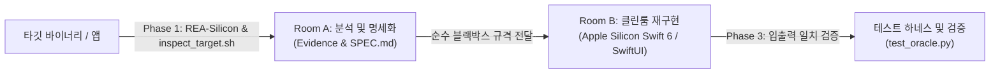

# REA-Silicon: 역공학 및 Apple Silicon 네이티브 재구현 가이드

> **Bilingual Navigation:**  
> - 🇺🇸 **English Version:** Please see [`docs/en/REA_REVERSE_ENGINEERING_GUIDE.md`](file:///Users/krazyeom/dev/rea/docs/en/REA_REVERSE_ENGINEERING_GUIDE.md)  
> - 🇰🇷 **한국어 완성본:** [`docs/kr/REA_REVERSE_ENGINEERING_GUIDE.md`](file:///Users/krazyeom/dev/rea/docs/kr/REA_REVERSE_ENGINEERING_GUIDE.md)  
> - 🍏 **Apple Silicon Rebuild Guide:** [`docs/en/MAC_SILICON_REBUILD_GUIDE.md`](file:///Users/krazyeom/dev/rea/docs/en/MAC_SILICON_REBUILD_GUIDE.md) / [`docs/kr/MAC_SILICON_REBUILD_GUIDE.md`](file:///Users/krazyeom/dev/rea/docs/kr/MAC_SILICON_REBUILD_GUIDE.md)  
> - 🤖 **Agent Rules & SOP:** [`docs/en/WORKFLOW_AND_RULES.md`](file:///Users/krazyeom/dev/rea/docs/en/WORKFLOW_AND_RULES.md) / [`docs/kr/WORKFLOW_AND_RULES.md`](file:///Users/krazyeom/dev/rea/docs/kr/WORKFLOW_AND_RULES.md)

---

**REA-Silicon**은 **REA (Reverse Engineer Anything)** 분석 도구 및 MCP 서버를 활용하여 기존 바이너리, 애플리케이션, 번들 코드를 역공학하고 최신 **Apple Silicon (macOS arm64) 네이티브 기술 스택(Swift 6, SwiftUI, AppKit)**으로 안전하게 재구현(Clean-room Rebuild)하기 위한 실전 가이드입니다.

---

## 📌 핵심 워크플로우 (Clean-Room Workflow)



---

## 1. 빠른 시작: 앱 위치만으로 분석 및 재개발 실행하기

터미널이나 AI 에이전트 대화창에 분석할 애플리케이션 경로를 지정합니다:

```bash
# 1. 타깃 기술 스택 및 바이너리 구조 자동 진단
./scripts/inspect_target.sh /Applications/TargetApp.app
```

에이전트에게는 다음과 같이 명령할 수 있습니다:
> `"이 애플리케이션(/Applications/LegacyTool.app)을 분석해서 Apple Silicon Native Swift 6 CLI 도구로 재개발해줘."`

에이전트는 [`AGENTS.md`](file:///Users/krazyeom/dev/rea/AGENTS.md) 규칙에 따라 `SPEC.md`를 작성하고 Swift 패키지로 즉시 구현합니다.

---

## 2. 재설계된 영문 프롬프트 (Re-engineered English Prompts)

### Room A: Analysis & Black-Box Specification Extraction (`SPEC.md`)
```markdown
You are a Principal Reverse Engineering Analyst (Room A Operator for REA-Silicon).
Analyze the internal logic and operation of the specified target using REA tools and macOS utilities. Produce a comprehensive, clean-room black-box specification document (`SPEC.md`).

[Target Information]
- Target File / Bundle Path: {{TARGET_PATH}}
- Key Feature / Component to Analyze: {{FEATURE_NAME}}
- Original Platform / Format: {{TARGET_FORMAT}}

[Analysis Instructions]
1. Run `./scripts/inspect_target.sh {{TARGET_PATH}}` to inspect architectures, linkage, and runtime heuristics.
2. Trace binary entrypoints, symbol tables, and exported interfaces.
3. Model state machines, parameter types, byte-offsets, endianness, validation rules, and error conditions.
4. Strictly forbid verbatim copying of decompiled C/C++ or assembly listings. Abstract all logic into structured pseudo-code.
5. Record an Evidence Log with symbol names, function offsets, strings, and confidence ratings ([Definite] / [Inferred]).

Format the output strictly according to `docs/en/SPEC_TEMPLATE.md`.
```

### Room B: Apple Silicon Native Rebuild (Swift 6 / SwiftUI)
```markdown
You are a Senior macOS Systems Engineer (Room B Clean-Room Implementer for REA-Silicon).
Using ONLY the requirements documented in `SPEC.md`, develop a clean-room native macOS implementation optimized for Apple Silicon (arm64).

[Implementation Context]
- Specification Source: `SPEC.md`
- Target Stack: Swift 6, SwiftUI / AppKit, Swift Concurrency
- Target Architecture: `arm64-apple-macosx14.0+`
- Project Archetype: {{PROJECT_TYPE}} (CLI Tool / Desktop SwiftUI App / Menu Bar Extra / Daemon)

[Engineering Requirements]
1. Faithfully implement all data interfaces, error modes, and state transitions described in `SPEC.md`.
2. Adhere to Swift 6 strict concurrency (`actor`, `async`/`await`, `Sendable`).
3. Replace legacy runtime artifacts with native macOS technologies.
4. Provide a complete `Package.swift` and compilable source files in `Sources/`.
5. Verify native compilation using `./scripts/verify_build.sh .`.
```

### Phase 3: Verification & Test Oracle
```markdown
You are a Verification and Quality Assurance Engineer (Test Oracle Specialist for REA-Silicon).
Construct an automated differential test harness and test oracle suite to verify that the newly rebuilt Apple Silicon Swift binary matches the original target's specification.

[Verification Requirements]
1. Develop test vectors covering nominal, boundary, and malformed inputs.
2. Provide an automated script comparing exit codes, STDOUT, and binary outputs between original and new builds.
3. Deliver a summary report detailing compatibility score, execution benchmarks, and memory usage reduction.
```

---

## 3. 상세 문서 링크 (Documentation Sitemap)

모든 가이드와 프롬프트는 영문과 한국어로 각각 제공됩니다:

- 🇺🇸 **English**:
  - [Complete Reverse Engineering Guide](file:///Users/krazyeom/dev/rea/docs/en/REA_REVERSE_ENGINEERING_GUIDE.md)
  - [Apple Silicon Native Rebuild Guide](file:///Users/krazyeom/dev/rea/docs/en/MAC_SILICON_REBUILD_GUIDE.md)
  - [Agent Rules & Execution Workflow](file:///Users/krazyeom/dev/rea/docs/en/WORKFLOW_AND_RULES.md)
  - [Clean-Room Specification Template](file:///Users/krazyeom/dev/rea/docs/en/SPEC_TEMPLATE.md)
  - [Engineered Prompts Catalog](file:///Users/krazyeom/dev/rea/docs/en/PROMPTS.md)

- 🇰🇷 **한국어 (Korean)**:
  - [역공학 및 재개발 통합 가이드](file:///Users/krazyeom/dev/rea/docs/kr/REA_REVERSE_ENGINEERING_GUIDE.md)
  - [Apple Silicon 네이티브 재개발 가이드](file:///Users/krazyeom/dev/rea/docs/kr/MAC_SILICON_REBUILD_GUIDE.md)
  - [에이전트 실행 규칙 및 워크플로우 정의서](file:///Users/krazyeom/dev/rea/docs/kr/WORKFLOW_AND_RULES.md)
  - [클린룸 사양서 템플릿](file:///Users/krazyeom/dev/rea/docs/kr/SPEC_TEMPLATE.md)
  - [프롬프트 카탈로그](file:///Users/krazyeom/dev/rea/docs/kr/PROMPTS.md)
