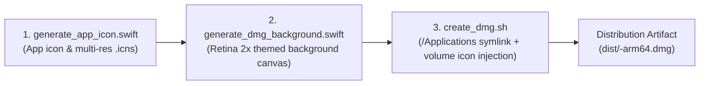

# Project-Specific DMG Packaging & Visual Branding Guide

This guide establishes the standard engineering protocol for creating customized, project-tailored **macOS Apple Silicon `.dmg` installers** within the **REA-Silicon** framework. Each disk image is engineered to reflect the target project's unique domain identity, signature homage icon, and dual-color theme palette.

---

## 1. Objectives & Value of Project-Themed DMGs

Standard, unadorned macOS disk images look generic and offer little reassurance to end users. A meticulously branded DMG delivers crucial competitive and operational advantages:

1. **Native Polish Matching Apple Silicon Standards**: Instills instant confidence through Big Sur+ style squircle iconography, ambient glows, and crisp 2x Retina visual art.
2. **Intuitive Drag-and-Drop Installation**: Features clear directional guides connecting the app bundle on the left to the `/Applications` folder shortcut on the right.
3. **Custom Volume Icon Branding**: Replaces the generic macOS white drive icon on the Desktop and Finder sidebar with the project's own `.VolumeIcon.icns`.
4. **Security & Distribution Integrity**: Packages binaries with Apple Silicon ad-hoc code signatures (`codesign`) and validates disk image checksums (`hdiutil verify`).

---

## 2. The Four Pillars of Project Identity

When preparing a DMG for any rebuilt application, define the following four core attributes:

| Pillar | Purpose | Example (`Calcuroo`) | Example (`PacketBoy`) |
| :--- | :--- | :--- | :--- |
| **Homage Name** | Witty parody/homage name evoking functionality while avoiding trademark infringement | `Calcuroo` (Homage to Calculator) | `PacketBoy` (Homage to Postman) |
| **Signature Symbol** | Distinctive emoji or SF Symbol representing domain purpose | 🧮 (Abacus / Math) | 📮 (Postbox / HTTP Packet) |
| **Dual Theme Palette** | Primary brand color and secondary accent color | `#10B981` (Emerald) ➔ `#047857` (Forest) | `#F59E0B` (Amber) ➔ `#D97706` (Flame) |
| **Project Tagline** | Concise one-line subtitle displayed on the DMG header | `Apple Silicon Native Calculator` | `Ultra-Fast Local API & Packet Explorer` |

---

## 3. Recommended Category Palette & Symbol Matrix

Select appropriate colors, symbols, and subtitles based on the application's domain:

| Domain Category | Homage Name Examples | Symbol | Primary (`Hex1`) | Secondary (`Hex2`) | Recommended Tagline |
| :--- | :--- | :---: | :---: | :---: | :--- |
| **Productivity & Math** | `Calcuroo`, `NumCraft` | 🧮 | `#10B981` | `#047857` | `Apple Silicon Native Calculator` |
| **API & Networking** | `PacketBoy`, `Stampy` | 📮 | `#F59E0B` | `#D97706` | `Zero-Overhead Local HTTP Inspector` |
| **Messaging & Team Chat** | `Taut`, `ChitChatter` | 💬 | `#6366F1` | `#4338CA` | `Instant Native Team Messenger` |
| **Containers & DevOps** | `HarborMaster`, `WhalePod` | ⚓️ | `#0EA5E9` | `#0369A1` | `Lightweight Container Control Room` |
| **Markdown & Notes** | `QuillFlow`, `InkSpire` | 🖋️ | `#14B8A6` | `#0F766E` | `Distraction-Free Markdown Studio` |
| **Media & Audio** | `SonicWave`, `TuneSmith` | 🎵 | `#F43F5E` | `#BE123C` | `High-Fidelity Audio Transformer` |
| **System & Security** | `SiliconGuard`, `SentryMac` | 🛡️ | `#64748B` | `#334155` | `Apple Silicon Kernel Monitor` |

---

## 4. Visual Asset & DMG Build Pipeline

REA-Silicon automates the entire DMG asset generation and packaging sequence:



### Step 1: Generate High-Resolution App Icon
```bash
./scripts/generate_app_icon.swift "<AppName>" ./Resources "<Symbol>" "<Hex1>" "<Hex2>"
# Example:
./scripts/generate_app_icon.swift "Calcuroo" ./Resources "🧮" "#10B981" "#047857"
```
- Artifacts: `Resources/AppIcon.icns`, `Resources/icon_1024.png`

### Step 2 & 3: Package Tailored DMG in One Step
Pass the project's identity attributes directly into `create_dmg.sh`:
```bash
./scripts/create_dmg.sh <PROJECT_OR_APP_PATH> [OUTPUT_DMG] [OPTIONS]
```

**Real-world invocations:**
```bash
# Calcuroo project:
./scripts/create_dmg.sh ./projects/Calcuroo ./dist/Calcuroo-1.0.0-arm64.dmg \
  --icon ./Resources/AppIcon.icns \
  --color1 "#10B981" \
  --color2 "#047857" \
  --subtitle "High-Precision Apple Silicon Calculator"

# PacketBoy project:
./scripts/create_dmg.sh ./build/PacketBoy.app ./dist/PacketBoy-arm64.dmg \
  --icon ./Resources/AppIcon.icns \
  --color1 "#F59E0B" \
  --color2 "#D97706" \
  --subtitle "Zero-Overhead Local HTTP Inspector"
```

---

## 5. `create_dmg.sh` CLI Options Reference

| Option Flag | Description | Default |
| :--- | :--- | :--- |
| `-n, --name <name>` | Application name | Inferred from bundle or folder |
| `-i, --icon <path>` | Path to `AppIcon.icns` file | Discovered automatically in `Resources/` |
| `-c1, --color1 <hex>` | Primary brand theme color | `#2563EB` |
| `-c2, --color2 <hex>` | Secondary accent theme color | `#1E40AF` |
| `-s, --subtitle <text>` | Tagline subtitle rendered on DMG header | `Apple Silicon Native Edition` |
| `--bg, --background <path>` | Path to pre-rendered 1280x800 background image | Automatically generated from theme colors |
| `-v, --version <ver>` | Release version string | `1.0.0` |
| `-b, --bundle-id <id>` | macOS Bundle Identifier | `com.reasilicon.<appname>` |
| `-V, --volname <vol>` | Mounted disk image volume label | `<AppName> Installer` |

---

## 6. Visual Layout Specifications

The generated DMG visual canvas complies with Apple Human Interface Guidelines:

```text
+-------------------------------------------------------------------+
|  [Calcuroo]                                                       |
|  High-Precision Apple Silicon Calculator                          |
|                                                                   |
|      +-------------+                     +-------------+          |
|      |             |                     |             |          |
|      |   Calcuroo  |   ==============>   |Applications |          |
|      |    (.app)   |    [Drag to Install]|  (Folder)   |          |
|      |             |                     |             |          |
|      +-------------+                     +-------------+          |
|                                                                   |
|  Apple Silicon Native (arm64) • Swift 6                           |
+-------------------------------------------------------------------+
```

- **Canvas Size**: 640pt wide × 400pt high (1280px × 800px @2x Retina).
- **Left Drop Target (App Bundle)**: Center aligned at `(x: 160pt, y: 195pt)` with subtle guide pod.
- **Right Drop Target (Applications)**: Center aligned at `(x: 480pt, y: 195pt)`.
- **Directional Guide**: Themed gradient directional arrow with installation prompt badge.
- **Backdrop Art**: Modern dark metallic gradient (`#111317` ➔ `#07080A`) layered with an ambient radial glow tuned to the project's primary color.

---

## 7. QA & Verification Checklist

Before releasing any DMG:

- [ ] **Checksum Validity**: Run `hdiutil verify <file.dmg>` and verify `checksum is VALID`.
- [ ] **Mount Test**: Run `open <file.dmg>` to verify seamless mounting.
- [ ] **Volume Icon Display**: Verify the mounted volume in Finder and Desktop displays the custom icon, not the generic white drive.
- [ ] **Drag-to-Applications Check**: Confirm dragging the `.app` bundle into `/Applications` copies the bundle cleanly.
- [ ] **Code Signature**: Confirm ad-hoc code signature via `codesign -dv --verbose=4 <copied_app>`.
