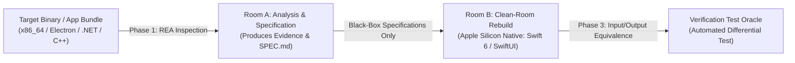

# REA-Silicon (Reverse Engineer Anything for Apple Silicon): Comprehensive Guide

This guide establishes the comprehensive framework for **REA-Silicon**, leveraging reverse-engineering tools and MCP servers to deconstruct legacy binaries and safely rebuild them into **high-performance, modern Apple Silicon (macOS arm64) native applications** using clean-room methodologies.

---

## 📌 Table of Contents
1. [Architectural Overview & Clean-Room Methodology](#1-architectural-overview--clean-room-methodology)
2. [Automated Inspection & Technology Stack Profiling](#2-automated-inspection--technology-stack-profiling)
3. [The 3-Phase Clean-Room Prompt Framework](#3-the-3-phase-clean-room-prompt-framework)
   - [Phase 1: Room A – Analysis & Black-Box Specification (`SPEC.md`)](#phase-1-room-a--analysis--black-box-specification-specmd)
   - [Phase 2: Room B – Apple Silicon Native Rebuild (Swift 6 / SwiftUI)](#phase-2-room-b--apple-silicon-native-rebuild-swift-6--swiftui)
   - [Phase 3: Verification – Test Harness & Oracle Validation](#phase-3-verification--test-harness--oracle-validation)
4. [All-in-One One-Shot Rebuild Prompt](#4-all-in-one-one-shot-rebuild-prompt)
5. [Target Application Profiling by Ecosystem](#5-target-application-profiling-by-ecosystem)
6. [Best Practices for Quality, Concurrency, and License Safety](#6-best-practices-for-quality-concurrency-and-license-safety)

---

## 1. Architectural Overview & Clean-Room Methodology

REA empowers AI agents to interface locally and safely with disassemblers, decompilers, AST extractors, and binary analyzers (such as Ghidra, Hopper, IDA Pro, JADX, and macOS `otool`/`lipo`). 

To guarantee legal safety, eliminate technical debt, and prevent copyright contamination, we enforce the **Clean-Room Engineering Pattern**:



---

## 2. Automated Inspection & Technology Stack Profiling

Before diving into decompilation, run the automated target inspector:

```bash
./scripts/inspect_target.sh /path/to/target_app.app
```

This immediately reveals:
- Mach-O architecture slices (`arm64`, `x86_64`)
- Linked libraries and system frameworks (`otool -L`)
- Code signature entitlements and Bundle identifiers
- Runtime fingerprinting (Electron ASAR, Qt, .NET, Go, Python, Swift, Objective-C)

For detailed migration strategies to Apple Silicon, see [MAC_SILICON_REBUILD_GUIDE.md](file:///Users/krazyeom/dev/rea/docs/en/MAC_SILICON_REBUILD_GUIDE.md).

---

## 3. The 3-Phase Clean-Room Prompt Framework

### Phase 1: Room A – Analysis & Black-Box Specification (`SPEC.md`)
> **Goal:** Deconstruct target behavior, calling conventions, data structures, and algorithms into a pure black-box specification (`SPEC.md`) following [`SPEC_TEMPLATE.md`](file:///Users/krazyeom/dev/rea/docs/en/SPEC_TEMPLATE.md).

```markdown
You are a Principal Reverse Engineering Analyst (Room A Operator).
Analyze the internal logic and operation of the specified target using REA tools and macOS utilities. Produce a comprehensive, clean-room black-box specification document (`SPEC.md`).

[Target Information]
- Target File / Bundle Path: {{TARGET_PATH}} (e.g., /Applications/LegacyApp.app, ./bin/daemon)
- Key Feature / Component to Analyze: {{FEATURE_NAME}} (e.g., Custom serialization protocol, auth handshake)
- Original Platform / Format: {{TARGET_FORMAT}} (e.g., macOS x86_64 Mach-O, Electron JS, .NET C#)

[Analysis Instructions]
1. Run `./scripts/inspect_target.sh {{TARGET_PATH}}` to map the target structure and dynamic linkage.
2. Trace the call graph and identify entrypoints for the target feature.
3. Model state machines, parameter types, byte-offsets, endianness, validation rules, and error conditions.
4. Strictly forbid verbatim copying of decompiled C/C++ or assembly listings. Abstract all logic into structured pseudo-code.
5. Record an Evidence Log with symbol names, function offsets, strings, and confidence ratings ([Definite] / [Inferred]).

Format the output strictly according to `docs/en/SPEC_TEMPLATE.md`.
```

---

### Phase 2: Room B – Apple Silicon Native Rebuild (Swift 6 / SwiftUI)
> **Goal:** Read ONLY `SPEC.md` and build an idiomatic, high-performance native macOS Apple Silicon (`arm64`) application.

```markdown
You are a Senior macOS Systems Engineer (Room B Clean-Room Implementer).
Using ONLY the requirements documented in `SPEC.md`, develop a clean-room native macOS implementation optimized for Apple Silicon (arm64).

[Implementation Context]
- Specification Source: `SPEC.md`
- Target Stack: Swift 6, SwiftUI / AppKit, Swift Concurrency
- Target Architecture: `arm64-apple-macosx14.0+`
- Project Archetype: {{PROJECT_TYPE}} (CLI Tool / Desktop SwiftUI App / Menu Bar Extra / Daemon)

[Engineering Requirements]
1. Faithfully implement all data interfaces, error modes, and state transitions described in `SPEC.md`.
2. Adhere to Swift 6 strict concurrency (`actor`, `async`/`await`, `Sendable`).
3. Replace legacy runtime artifacts with native macOS technologies (e.g., `swift-argument-parser`, `SwiftData`, `MenuBarExtra`).
4. Provide a complete `Package.swift` and compilable source files in `Sources/`.
5. Verify native compilation using `./scripts/verify_build.sh .`.
```

---

### Phase 3: Verification – Test Harness & Oracle Validation
> **Goal:** Validate that both original and newly rebuilt programs produce identical output across identical inputs.

```markdown
You are a Verification and Quality Assurance Engineer (Test Oracle Specialist).
Construct an automated differential test harness and test oracle suite to verify that the newly rebuilt Apple Silicon Swift binary matches the original target's specification.

[Verification Requirements]
1. Develop test vectors covering:
   - Nominal inputs (happy path)
   - Boundary values (0-length buffers, maximum buffer limits, special characters)
   - Malformed inputs and exception handling
2. Provide an automated script comparing exit codes, STDOUT, and binary outputs between original and new builds.
3. Deliver a summary report detailing compatibility score, execution benchmarks, and memory usage reduction.
```

---

## 4. All-in-One One-Shot Rebuild Prompt

For small utilities, single algorithms, or rapid prototyping:

```markdown
Analyze the target binary at `{{TARGET_PATH}}` using REA tools and rebuild it into an Apple Silicon native (`arm64`) Swift 6 program.

[Workflow]
1. [Inspect & Profile]: Run `./scripts/inspect_target.sh {{TARGET_PATH}}` to detect dependencies and stack.
2. [Specification]: Summarize data structures, command-line arguments, and algorithms into clean-room pseudo-code.
3. [Rebuild]: Produce a complete `Package.swift` and native Swift implementation for `arm64-apple-macosx14.0`.
4. [Verify]: Compile with `arch -arm64 swift build` and run smoke tests validating behavior.
```

---

## 5. Target Application Profiling by Ecosystem

| Source Stack | Primary Inspection Tool | Target Swift Modernization Pattern |
| :--- | :--- | :--- |
| **Mach-O Native** (C/C++, Rust, Go) | `otool -L`, `lipo`, `nm`, Ghidra | Swift 6 native CLI / Framework, zero memory leak ARC |
| **Electron / Node.js** (.asar) | ASAR extractor, AST inspector | SwiftUI window, replace IPC with Swift actors, sub-15MB RAM |
| **.NET / C#** (Assemblies) | IL / Decompiler, strings | Swift 6 models, `Codable`, `SwiftData` persistence |
| **Python** (PyInstaller) | PyInstaller archive extractor, uncompyle | Pure Swift CLI with `ArgumentParser`, zero Python dependency |

---

## 6. Best Practices for Quality, Concurrency, and License Safety

1. **Keep Analysis Scopes Targeted**: Do not attempt to reverse engineer an entire 200MB binary in one turn. Focus on specific functional modules (e.g., payload parser, authentication protocol, engine core).
2. **Prevent Model Hallucinations**: Always instruct the agent to cite offsets, string literals, and dynamic symbols in the Evidence Log.
3. **Mandatory Apple Silicon Signing**: Always remember that macOS on Apple Silicon requires all executable code to be signed (`codesign --force --deep --sign - <path>`).
