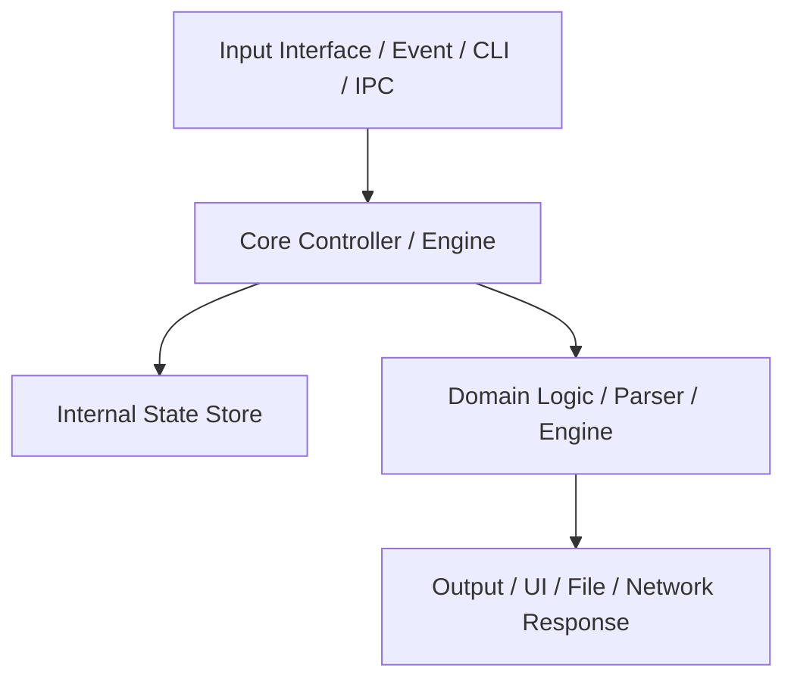

# Black-Box Specification: {{WITTY_REBUILT_APP_NAME}}

> **Specification Version:** 1.0.0  
> **Original Target App:** `{{ORIGINAL_TARGET_APP_NAME}}` (Do NOT reuse exact trademark)  
> **Witty Homage Name:** `{{WITTY_REBUILT_APP_NAME}}` (e.g., `Calcuroo`, `PacketBoy`, `Taut`)  
> **Visual Identity:** Signature Symbol `{{SYMBOL_OR_EMOJI}}`, Theme Colors `{{PRIMARY_HEX}}` / `{{SECONDARY_HEX}}`  
> **Target Rebuild Architecture:** macOS Apple Silicon Native (arm64 / Swift 6 / SwiftUI)  
> **Clean-Room Boundary:** Room A Specification (Strictly Zero Original Proprietary Code Copy)

---

## 1. System Overview & Witty Branding Concept
Briefly describe the overall responsibility, business logic, and functional purpose of the target component/application extracted during reverse engineering.

- **Original Binary/App:** `{{TARGET_ORIGINAL_PATH}}`
- **Original Architecture & Stack:** `{{ORIGINAL_STACK}}` (e.g., x86_64 Mach-O, Electron/Node.js, .NET C#, C++ Qt)
- **Witty Homage Naming Rationale:** Explanation of the witty parody/homage name chosen.
- **App Icon Generation Metadata:**
  - CLI Command: `./scripts/generate_app_icon.swift "{{WITTY_REBUILT_APP_NAME}}" ./Resources "{{SYMBOL_OR_EMOJI}}" "{{PRIMARY_HEX}}" "{{SECONDARY_HEX}}"`
  - Deliverables: `AppIcon.icns`, `icon_1024.png`
- **Target Replacement Stack:** Swift 6, SwiftUI / AppKit, native `arm64-apple-macosx`

---

## 2. Core Architecture & Component Breakdown



### 2.1 State Model & Life-cycle
- **States:** `Uninitialized`, `Ready`, `Processing`, `Error`, `Terminated`
- **State Transition Triggers:** Detail how internal state evolves upon events or input data.

---

## 3. Interfaces & Data Formats

### 3.1 Input Formats
- **Parameters / Payload:**
  - `field_1` (Type: `String`, Required): Description & validation constraint
  - `field_2` (Type: `UInt32` Little-Endian, Optional): Description
- **Boundary & Validation Rules:**
  - Max buffer size: `8192` bytes
  - Encoding: UTF-8 / Raw Byte Array

### 3.2 Output Formats
- **Success Response:**
  - Structure, fields, types, and expected status codes or return values.
- **Error Modes & Failure Codes:**
  - Specific error conditions, exception codes, and error representations.

---

## 4. Algorithmic Specification (Black-box Logic)

> [!IMPORTANT]
> Do NOT paste decompiled C/C++ or assembly code here. Describe the mathematical, logical, and structural behavior in pseudo-code or step-by-step algorithms.

```text
Algorithm: ProcessPayload(input_buffer)
1. Assert length of input_buffer >= HEADER_SIZE (16 bytes).
2. Read magic bytes [0..3]; verify match with expected magic.
3. Decrypt or decode payload using verified algorithm:
   - Cipher: AES-256-GCM / ChaCha20-Poly1305 / Custom XOR mask.
   - IV / Nonce derivation: bytes [4..15].
4. Parse structured records.
5. Return strongly-typed result model.
```

---

## 5. macOS Apple Silicon Native Integration Requirements

- **Concurrency Model:** Swift `async`/`await`, `TaskGroup`, `@MainActor` for UI updates.
- **Memory & SIMD:** Utilize Swift standard library, `Accelerate.framework` / `vImage` / `Metal` if compute-intensive.
- **System Integration:**
  - CLI: `ArgumentParser` package
  - GUI: `SwiftUI` App life-cycle, macOS 14+ / 15+ target
  - Menu Bar / Daemon: `MenuBarExtra`, `SMAppService` (launchd daemon)

---

## 6. Test Vectors & Oracle Verification Data

| Test Case ID | Input Vector / Arguments | Expected Output / State | Notes |
| :--- | :--- | :--- | :--- |
| `TC-01` (Nominal) | `sample_input_01.dat` | Status `OK`, payload matches | Baseline happy path |
| `TC-02` (Boundary) | Empty buffer (0 bytes) | Error `ErrBufferTooShort` | Edge case validation |
| `TC-03` (Malformed) | Invalid magic header | Error `ErrInvalidMagic` | Security / crash resilience |

---

## 7. Evidence & Traceability Log

| Item / Behavior | Observation Point (Symbol / String / Offset) | Confidence | Notes |
| :--- | :--- | :--- | :--- |
| Handshake sequence | String `"AUTH_V2_CLIENT_HELLO"`, offset `0x10003A4B0` | Definite | Verified in strings & call graph |
| Framing protocol | Function `parse_header`, dynamic library `libcore.dylib` | Inferred | Frame header has 4-byte big-endian length |
