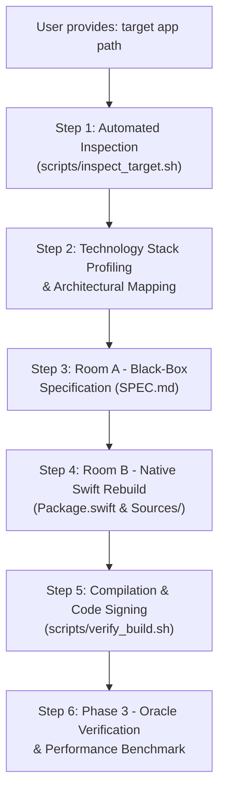

# Agent Rules & Execution Workflow: Reverse Engineering & Apple Silicon Rebuild

This document defines the strict operational rules and automated workflow that AI agents and engineers MUST follow when analyzing any application and rebuilding it into a native macOS Apple Silicon (`arm64`) application.

---

## 0. Quick One-Line LLM CLI Execution

You can launch the complete end-to-end analysis and rebuild pipeline simply by providing the path to `aaa.app`:

```bash
# Option 1: One-Touch Wrapper Script (Recommended)
./scripts/rebuild_app.sh /Applications/aaa.app

# Option 2: Direct Antigravity CLI (agy)
agy "Analyze and rebuild for Apple Silicon Native: /Applications/aaa.app"

# Option 3: Claude Code CLI (claude)
claude "Analyze and rebuild for Apple Silicon Native: /Applications/aaa.app"
```

---

## 1. Trigger Conditions & Operating Contract

When the user provides an application path (e.g., `/Applications/Example.app`, `/path/to/binary`, or a local bundle), the agent **MUST** activate this protocol:

1. **Rule File Reading**: Before performing any actions, the agent must inspect:
   - `docs/en/MAC_SILICON_REBUILD_GUIDE.md` (or `docs/kr/MAC_SILICON_REBUILD_GUIDE.md`)
   - `docs/en/SPEC_TEMPLATE.md`
   - `docs/en/PROMPTS.md`
2. **Apple Silicon Native Priority**: Unless explicitly requested otherwise, all rebuilds MUST target `arm64-apple-macosx` using modern **Swift 6 / SwiftUI / AppKit**.
3. **Clean-Room Isolation**: Under no circumstances should original proprietary source code or disassembly listings be copied into the final code. Implementation must proceed strictly through `SPEC.md`.

---

## 2. Standard Operating Procedure (SOP)



### Step 1: Automated Target Inspection
Run the bundled analyzer script on the user-supplied path:
```bash
./scripts/inspect_target.sh <TARGET_APP_PATH>
```
Output to parse:
- Executable binary location inside `.app` (e.g., `Contents/MacOS/<Executable>`)
- Architecture slice support (`arm64`, `x86_64`, Universal)
- Frameworks and dylib linkage (`otool -L`)
- Runtime fingerprinting (Electron, Qt, .NET, Go, Python, Swift, Objective-C)

### Step 2: Technology Stack Profiling & Architectural Plan
Formulate the architecture plan according to `docs/en/MAC_SILICON_REBUILD_GUIDE.md`:
- If **Electron / Web**: Plan migration to native **SwiftUI** or **AppKit**, replacing IPC with native Swift actors.
- If **CLI tool / Daemon**: Plan a modern Swift package with `swift-argument-parser` and `SMAppService`.
- If **GUI tool (C++/Qt/.NET)**: Plan modern declarative SwiftUI views with `@Observable` state models.

### Step 3: Room A – Extract Black-Box Specification (`SPEC.md`)
1. Utilize disassemblers/decompilers (Ghidra, Hopper, strings, AST analysis) to understand core business logic.
2. Fill out `SPEC.md` using the template at `docs/en/SPEC_TEMPLATE.md`.
3. Ensure all algorithmic steps are written in pseudo-code and test vectors are documented in Section 6.

### Step 4: Room B – Clean-Room Native Re-implementation
1. Scaffold an idiomatic Swift Package or Xcode project:
   ```bash
   mkdir -p rebuilt_app/Sources rebuilt_app/Tests
   ```
2. Write `Package.swift` configured for `arm64-apple-macosx14.0+`.
3. Implement clean, type-safe Swift 6 code complying with strict concurrency.

### Step 5: Native Compilation and Ad-Hoc Signing
Compile the native binary:
```bash
arch -arm64 swift build -c release --triple arm64-apple-macosx14.0
```
Sign the output binary:
```bash
codesign --force --deep --sign - .build/arm64-apple-macosx/release/<BinaryName>
```

### Step 6: Differential Testing & Test Oracle
Execute the verification script or differential test runner:
```bash
./scripts/verify_build.sh rebuilt_app
```
Confirm input/output equivalence against the test vectors recorded in `SPEC.md`.

---

## 3. Mandatory Quality & Safety Gates

1. **No Proprietary Code Leak**: Verification that zero disassembled C/C++ or machine code appears in source files.
2. **Native Apple Silicon Verification**: Ensure `file <binary>` reports `Mach-O 64-bit executable arm64`.
3. **Strict Concurrency Compliance**: Ensure zero data race warnings under Swift 6 compiler flags.
