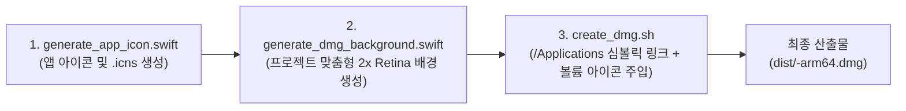

# 프로젝트 특화형 DMG 제작 및 비주얼 브랜딩 가이드
(Project-Specific DMG Packaging & Visual Branding Guide)

본 문서는 **REA-Silicon** 프레임워크를 통해 역공학 및 재개발된 각 애플리케이션의 고유한 도메인 특성, 시그니처 아이콘, 테마 색상을 온전히 반영한 **맞춤형 macOS Apple Silicon 배포용 `.dmg` 인스톨러**를 설계하고 제작하는 표준 지침을 제공합니다.

---

## 1. 프로젝트 맞춤형 DMG의 필요성 및 가치

일반적인 무지(White) 디스크 이미지는 사용자에게 삭막한 인상을 주며, 설치 과정에서 어떤 동작을 해야 하는지 혼란을 줄 수 있습니다. 반면 프로젝트의 고유한 비주얼 아이덴티티가 적용된 DMG는 다음과 같은 결정적 가치를 제공합니다:

1. **원작을 뛰어넘는 네이티브 완성도**: Apple Silicon 네이티브 앱에 걸맞은 Big Sur+ 스쿼클 아이콘과 Retina 고해상도 그래픽을 첫 설치 단계부터 각인시킵니다.
2. **직관적인 드래그 앤 드롭 설치 경험**: 좌측 앱 번들에서 우측 `/Applications` 폴더로 이어지는 시각적 가이드 화살표를 통해 마우스 한 번으로 설치를 완료할 수 있습니다.
3. **볼륨 아이콘 브랜딩**: DMG를 마운트했을 때 바탕화면과 Finder 사이드바에 표준 흰색 외장 디스크가 아닌, **앱 고유의 아이콘**이 표시되어 브랜드 일체감을 극대화합니다.
4. **보안 및 무결성**: Ad-hoc 코드 서명 및 UDZO 압축 체크섬 검증을 거쳐 변조 위험 없는 신뢰할 수 있는 바이너리를 배포합니다.

---

## 2. 프로젝트 아이덴티티 4대 구성 요소

각 프로젝트의 DMG를 제작할 때는 다음 4가지 핵심 요소를 반드시 사전에 정의해야 합니다:

| 구성 요소 | 설명 | 예시 (`Calcuroo`) | 예시 (`PacketBoy`) |
| :--- | :--- | :--- | :--- |
| **위트 있는 명칭 (Homage Name)** | 원작 기능을 연상시키며 상표권을 회피하는 독창적 명칭 | `Calcuroo` (Calculator 오마주) | `PacketBoy` (Postman 오마주) |
| **시그니처 심볼 (Symbol / Emoji)** | 앱의 기능을 가장 직관적으로 나타내는 SF Symbol 또는 이모지 | 🧮 (주판/계산) | 📮 (우체통/패킷 전송) |
| **듀얼 테마 팔레트 (Dual Hex Colors)** | 브랜드 메인 색상(Primary)과 보조 액센트 색상(Secondary) | `#10B981` (Emerald) ➔ `#047857` (Forest) | `#F59E0B` (Amber) ➔ `#D97706` (Flame) |
| **프로젝트 슬로건 (Subtitle Tagline)** | DMG 상단에 표기될 앱의 기술적 성격 및 한 줄 소개 | `Apple Silicon Native Calculator` | `Ultra-Fast Local API & Packet Explorer` |

---

## 3. 도메인 카테고리별 추천 테마 및 브랜딩 매트릭스

프로젝트의 성격에 따라 다음의 추천 컬러 팔레트와 심볼을 활용하십시오:

| 카테고리 | 대표 추천 명칭 예시 | 심볼/이모지 | 주 색상 (`Hex1`) | 보조 색상 (`Hex2`) | 추천 슬로건 / 부제 |
| :--- | :--- | :---: | :---: | :---: | :--- |
| **생산성 / 계산 도구** | `Calcuroo`, `NumCraft` | 🧮 | `#10B981` | `#047857` | `Apple Silicon Native Calculator` |
| **네트워크 / API 테스팅** | `PacketBoy`, `Stampy` | 📮 | `#F59E0B` | `#D97706` | `Zero-Overhead Local HTTP Inspector` |
| **메신저 / 협업 툴** | `Taut`, `ChitChatter` | 💬 | `#6366F1` | `#4338CA` | `Instant Native Team Messenger` |
| **컨테이너 / 인프라** | `HarborMaster`, `WhalePod` | ⚓️ | `#0EA5E9` | `#0369A1` | `Lightweight Container Control Room` |
| **마크다운 / 노트 에디터** | `QuillFlow`, `InkSpire` | 🖋️ | `#14B8A6` | `#0F766E` | `Distraction-Free Markdown Studio` |
| **오디오 / 미디어 유틸리티** | `SonicWave`, `TuneSmith` | 🎵 | `#F43F5E` | `#BE123C` | `High-Fidelity Audio Transformer` |
| **시스템 관리 / 보안** | `SiliconGuard`, `SentryMac` | 🛡️ | `#64748B` | `#334155` | `Apple Silicon Kernel Monitor` |

---

## 4. 원클릭 비주얼 에셋 & DMG 빌드 파이프라인

REA-Silicon 프레임워크는 프로젝트 특화 DMG 제작을 위한 3대 스크립트를 제공합니다:



### 1단계: 프로젝트 고유 앱 아이콘 생성
```bash
./scripts/generate_app_icon.swift "<앱이름>" ./Resources "<심볼/이모지>" "<Hex1>" "<Hex2>"
# 예시:
./scripts/generate_app_icon.swift "Calcuroo" ./Resources "🧮" "#10B981" "#047857"
```
- 산출물: `Resources/AppIcon.icns`, `Resources/icon_1024.png`

### 2단계 & 3단계: 프로젝트 특화 DMG 원스톱 패키징
`scripts/create_dmg.sh`에 프로젝트의 테마 색상과 슬로건을 전달하면, 배경 아트와 볼륨 아이콘이 자동으로 합성되어 DMG로 패키징됩니다:
```bash
./scripts/create_dmg.sh <프로젝트경로_또는_앱번들> [출력DMG] [옵션]
```

**실제 실행 예시:**
```bash
# Calcuroo 프로젝트 예시:
./scripts/create_dmg.sh ./projects/Calcuroo ./dist/Calcuroo-1.0.0-arm64.dmg \
  --icon ./Resources/AppIcon.icns \
  --color1 "#10B981" \
  --color2 "#047857" \
  --subtitle "High-Precision Apple Silicon Calculator"

# PacketBoy 프로젝트 예시:
./scripts/create_dmg.sh ./build/PacketBoy.app ./dist/PacketBoy-arm64.dmg \
  --icon ./Resources/AppIcon.icns \
  --color1 "#F59E0B" \
  --color2 "#D97706" \
  --subtitle "Zero-Overhead Local HTTP Inspector"
```

---

## 5. `create_dmg.sh` CLI 옵션 레퍼런스

| 옵션 플래그 | 설명 | 기본값 |
| :--- | :--- | :--- |
| `-n, --name <이름>` | 애플리케이션 명칭 | 번들 또는 디렉토리명에서 자동 추출 |
| `-i, --icon <경로>` | 탑재할 `AppIcon.icns` 경로 | `Resources/AppIcon.icns` 자동 탐색 |
| `-c1, --color1 <Hex>` | 프로젝트 대표 테마 색상 (Hex 코드) | `#2563EB` |
| `-c2, --color2 <Hex>` | 프로젝트 보조 액센트 색상 (Hex 코드) | `#1E40AF` |
| `-s, --subtitle <설명>` | DMG 배경화면 상단에 표기할 프로젝트 슬로건 | `Apple Silicon Native Edition` |
| `--bg, --background <경로>` | 직접 제작한 1280x800 커스텀 PNG 배경 파일 | 자동 생성된 테마 배경 사용 |
| `-v, --version <버전>` | 애플리케이션 릴리즈 버전 | `1.0.0` |
| `-b, --bundle-id <ID>` | macOS 번들 식별자 (CFBundleIdentifier) | `com.reasilicon.<appname>` |
| `-V, --volname <볼륨명>` | Finder에 마운트될 디스크 볼륨 이름 | `<AppName> Installer` |

---

## 6. 내부 비주얼 레이아웃 및 UX 설계 사양

생성되는 DMG 내부 레이아웃은 macOS Human Interface Guidelines(HIG)를 준수합니다:

```text
+-------------------------------------------------------------------+
|  [Calcuroo]                                                       |
|  High-Precision Apple Silicon Calculator                          |
|                                                                   |
|      +-------------+                     +-------------+          |
|      |             |                     |             |          |
|      |   Calcuroo  |   ==============>   |Applications |          |
|      |    (.app)   |      [드래그 설치]   |  (Folder)   |          |
|      |             |                     |             |          |
|      +-------------+                     +-------------+          |
|                                                                   |
|  Apple Silicon Native (arm64) • Swift 6                           |
+-------------------------------------------------------------------+
```

1. **캔버스 해상도**: 가로 640pt × 세로 400pt (물리 1280px × 800px @2x Retina 지원).
2. **좌측 앱 번들 배치 구역**: `(x: 160pt, y: 195pt)` 중심에 정렬된 소프트 라운드 가이드 포드.
3. **우측 `/Applications` 바로가기 구역**: `(x: 480pt, y: 195pt)` 중심에 정렬된 설치 대상 포드.
4. **중앙 인터랙션 가이드**: 프로젝트 테마 색상이 은은하게 그라디언트된 화살표와 `드래그하여 설치 ➔` 안내 배지.
5. **다크 모드 융합형 배경**: macOS 시스템 외관(Dark/Light)과 자연스럽게 어우러지는 다크 메탈릭 베이스 (`#111317` ➔ `#07080A`) 및 프로젝트 테마 색상의 방사형 앰비언트 글로우(Ambient Radial Glow) 효과.

---

## 7. 검증 및 품질 보증 (QA Checklist)

배포용 DMG 생성을 완료한 후 다음 항목을 점검하십시오:

- [ ] **체크섬 무결성**: `hdiutil verify <파일.dmg>` 실행 시 `checksum is VALID` 확인.
- [ ] **마운트 테스트**: 터미널에서 `open <파일.dmg>` 실행 시 디스크 이미지가 즉시 열리는지 확인.
- [ ] **볼륨 아이콘 점검**: 바탕화면 및 Finder 좌측 사이드바에 흰색 기본 디스크가 아닌 커스텀 앱 아이콘이 정상 표시되는지 확인.
- [ ] **드래그 앤 드롭 설치 확인**: 앱 번들을 `Applications` 심볼릭 링크로 끌어다 놓았을 때 `/Applications` 폴더로 올바르게 복사되는지 확인.
- [ ] **Apple Silicon 커널 서명**: `codesign -dv --verbose=4 <복사된_앱>` 실행 시 서명 상태가 유효한지 확인.
