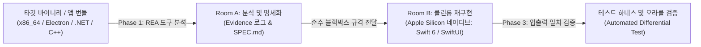

# REA (Reverse Engineer Anything): 역공학 및 Apple Silicon 네이티브 재개발 가이드

본 문서는 **REA (Reverse Engineer Anything)** 도구 및 MCP 서버를 활용하여 기존 바이너리, 애플리케이션, 번들 코드를 역공학하고, **고성능 모던 Apple Silicon (macOS arm64) 네이티브 애플리케이션(Swift 6 / SwiftUI)**으로 안전하게 재개발(Clean-room Rebuild)하기 위한 실전 프롬프트 템플릿과 실행 지침을 정리한 가이드입니다.

---

## 📌 목차
1. [아키텍처 개요 및 클린룸(Clean-Room) 방법론](#1-아키텍처-개요-및-클린룸clean-room-방법론)
2. [자동 진단 및 기술 스택 프로파일링](#2-자동-진단-및-기술-스택-프로파일링)
3. [3단계 클린룸 프롬프트 프레임워크](#3-3단계-클린룸-프롬프트-프레임워크)
   - [Phase 1: Room A – 분석 및 블랙박스 명세 추출 (`SPEC.md`)](#phase-1-room-a--분석-및-블랙박스-명세-추출-specmd)
   - [Phase 2: Room B – Apple Silicon 네이티브 재개발 (Swift 6 / SwiftUI)](#phase-2-room-b--apple-silicon-네이티브-재개발-swift-6--swiftui)
   - [Phase 3: Verification – 테스트 하네스 및 오라클 검증](#phase-3-verification--테스트-하네스-및-오라클-검증)
4. [올인원(All-in-One) 원샷 재개발 프롬프트](#4-올인원all-in-one-원샷-재개발-프롬프트)
5. [타깃 애플리케이션 기술 스택별 프로파일링](#5-타깃-애플리케이션-기술-스택별-프로파일링)
6. [품질, 동시성, 라이선스 안전을 위한 실무 지침](#6-품질-동시성-라이선스-안전을-위한-실무-지침)

---

## 1. 아키텍처 개요 및 클린룸(Clean-Room) 방법론

REA는 AI 에이전트가 Ghidra, Hopper, IDA Pro, JADX, macOS 내장 `otool`/`lipo` 등의 도구를 통해 로컬에서 대상 프로그램을 안전하게 분석할 수 있도록 지원합니다.

저작권 침해 위험을 원천 차단하고 기술 부채를 제거하기 위해 **분석(Room A)**과 **구현(Room B)**을 엄격히 격리하는 클린룸 패턴을 따릅니다:



---

## 2. 자동 진단 및 기술 스택 프로파일링

본 저장소에 내장된 자동 진단 스크립트를 실행하여 타깃 앱의 구조를 즉시 파악할 수 있습니다:

```bash
./scripts/inspect_target.sh /경로/대상파일_또는_앱.app
```

진단 결과 확인 항목:
- Mach-O 지원 아키텍처 (`arm64`, `x86_64`, Universal)
- 동적 링크 라이브러리 및 macOS 시스템 프레임워크 (`otool -L`)
- 코드 서명 정보 및 Entitlements
- 런타임 지문 감지 (Electron ASAR, Qt, .NET, Go, Python, Swift, Objective-C)

상세한 Apple Silicon 전환 전략은 [MAC_SILICON_REBUILD_GUIDE.md](file:///Users/krazyeom/dev/rea/docs/kr/MAC_SILICON_REBUILD_GUIDE.md)를 참고하세요.

---

## 3. 3단계 클린룸 프롬프트 프레임워크

### Phase 1: Room A – 분석 및 블랙박스 명세 추출 (`SPEC.md`)
> **목적:** REA 디컴파일러 및 macOS 도구를 활용해 타깃의 내부 로직을 파악하고, 원작 코드를 복사하지 않은 블랙박스 사양서(`SPEC.md`)를 [`SPEC_TEMPLATE.md`](file:///Users/krazyeom/dev/rea/docs/kr/SPEC_TEMPLATE.md)에 따라 작성합니다.

```markdown
당신은 수석 리버스 엔지니어링 분석가(Room A Operator)입니다.
REA 도구 및 macOS 유틸리티를 사용하여 지정된 타깃의 내부 로직과 동작 방식을 분석하고, 재구현을 위한 상세 블랙박스 기능 명세서(`SPEC.md`)를 작성해 주세요.

[타깃 정보]
- 대상 파일/경로: {{TARGET_PATH}} (예: /Applications/LegacyApp.app, ./bin/daemon)
- 집중 분석 컴포넌트/기능: {{FEATURE_NAME}} (예: 커스텀 패킷 프로토콜, 암호화 핸드셰이크)
- 대상 플랫폼/포맷: {{TARGET_FORMAT}} (예: macOS x86_64 Mach-O, Electron JS, .NET C#)

[분석 요구사항]
1. `./scripts/inspect_target.sh {{TARGET_PATH}}`를 실행하여 타깃의 구조와 동적 링킹을 파악하세요.
2. 호출 흐름(Call Graph)과 핵심 진입점(Entrypoint)을 식별하세요.
3. 상태 머신, 데이터 모델, 입출력 바이트 오더, 유효성 검증 규칙, 예외 처리 방식을 상세히 파악하세요.
4. 디컴파일된 C/C++ 소스코드나 어셈블리 명령어를 그대로 인용하지 마시고, 구조화된 의사코드(Pseudo-code)로 추상화하세요.
5. 심볼명, 함수 오프셋, 문자열 및 신뢰도([확실] / [추정])를 포함한 Evidence 로그를 작성하세요.

결과물은 `docs/kr/SPEC_TEMPLATE.md` 규격에 맞추어 `SPEC.md`로 정리해 주세요.
```

---

### Phase 2: Room B – Apple Silicon 네이티브 재개발 (Swift 6 / SwiftUI)
> **목적:** `SPEC.md`만을 참조하여 Apple Silicon (arm64)에 최적화된 최신 Swift 6 / SwiftUI 코드로 깨끗하게 재구현합니다.

```markdown
당신은 수석 macOS 시스템 엔지니어(Room B Clean-Room Implementer)입니다.
작성된 `SPEC.md` 명세서만을 유일한 참조 기준으로 삼아, Apple Silicon (arm64) 환경에 최적화된 고성능 macOS 네이티브 코드로 재구현해 주세요.

[구현 목표]
- 대상 명세: `SPEC.md`
- 타깃 기술 스택: Swift 6, SwiftUI / AppKit, Swift Concurrency
- 타깃 아키텍처: `arm64-apple-macosx14.0+`
- 프로젝트 구조: {{PROJECT_TYPE}} (CLI 도구 / 데스크톱 SwiftUI 앱 / 메뉴바 상주형 유틸리티 / 데몬)

[구현 요구사항]
1. `SPEC.md`에 명시된 데이터 입출력 형식, 에러 처리, 상태 전이를 정확히 일치시키세요.
2. Swift 6의 엄격한 동시성 모델(`Sendable`, `actor`, `async`/`await`)을 준수하세요.
3. 무거운 레거시 런타임을 macOS 네이티브 표준 기술(예: `swift-argument-parser`, `SwiftData`, `MenuBarExtra`)로 전면 현대화하세요.
4. `Package.swift`와 함께 `Sources/` 내에 즉시 컴파일 가능한 프로덕션 코드를 작성하세요.
5. `./scripts/verify_build.sh .`를 통해 컴파일 성공 여부를 검증하세요.
```

---

### Phase 3: Verification – 테스트 하네스 및 오라클 검증
> **목적:** 원본 타깃과 재개발된 Swift 바이너리가 동일한 입력에 대해 동일한 결과를 내는지 대조 검증합니다.

```markdown
당신은 검증 및 품질 보증 엔지니어(Test Oracle Specialist)입니다.
새로 재개발된 Apple Silicon Swift 바이너리가 원본의 동작 규격(`SPEC.md`)과 일치하는지 확인하기 위한 자동화된 대조 테스트 하네스를 구축해 주세요.

[검증 요구사항]
1. 다음 케이스를 포괄하는 테스트 벡터를 작성하세요:
   - 정상 시나리오 (Happy Path)
   - 경계값 (0바이트 버퍼, 최대 정수 한계 등)
   - 비정상/손상된 입력 및 예외 상황 처리
2. 원본 실행 파일의 출력과 재개발본의 출력을 비교하는 자동화 테스트 스크립트를 작성하세요.
3. 호환성 일치율, 실행 속도 벤치마크, 메모리 점유율 개선 결과를 요약하여 보고해 주세요.
```

---

## 4. 올인원(All-in-One) 원샷 재개발 프롬프트

작은 CLI 유틸리티나 프로토타입 기능을 하나의 프롬프트로 빠르게 분석 및 재개발할 때 사용합니다:

```markdown
REA 도구를 사용하여 타깃 프로그램 `{{TARGET_PATH}}`를 분석하고, 최신 Apple Silicon(`arm64`) 네이티브 Swift 6 프로그램으로 재구현해 주세요.

[실행 단계]
1. [Inspect & Profile]: `./scripts/inspect_target.sh {{TARGET_PATH}}`를 실행해 의존성과 기술 스택을 진단하세요.
2. [Specification]: 데이터 포맷, CLI 인자, 핵심 알고리즘을 클린룸 의사코드로 요약하세요.
3. [Rebuild]: `arm64-apple-macosx14.0`을 타깃으로 하는 `Package.swift` 및 네이티브 Swift 코드를 완성도 있게 작성하세요.
4. [Verify]: `arch -arm64 swift build`로 컴파일을 검증하고 테스트 결과를 확인하세요.
```

---

## 5. 타깃 애플리케이션 기술 스택별 프로파일링

| 원본 기술 스택 | 주요 REA 도구 / 접근 방식 | Apple Silicon 네이티브 전환 전략 |
| :--- | :--- | :--- |
| **Mach-O 바이너리** (C/C++, Rust, Go) | `otool -L`, `lipo`, `nm`, Ghidra | Swift 6 네이티브 패키지, ARC 기반 무누수 메모리 모델 |
| **Electron / 웹 번들** (.asar, Webpack) | ASAR 추출기, AST 분석기 | SwiftUI 창 기반 앱, IPC를 Swift actor로 전환, 메모리 95% 절감 |
| **.NET / C#** (Assemblies) | IL / Decompiler 어댑터 | Swift 6 데이터 모델, `Codable`, `SwiftData` |
| **Python** (PyInstaller) | PyInstaller 아카이브 추출 도구 | Swift CLI (`ArgumentParser`), 외부 파이썬 런타임 완전 제거 |

---

## 6. 품질, 동시성, 라이선스 안전을 위한 실무 지침

1. **분석 범위 좁히기**: 수백 메가바이트의 거대한 바이너리 전체를 한 번에 리버스 엔지니어링하려 하지 마시고, 핵심 비즈니스 모듈(예: 암호화 엔진, 패킷 파서, 핵심 로직) 단위로 좁혀 질의하세요.
2. **환각(Hallucination) 방지**: 모호한 부분은 에이전트에게 `"해당 로직의 근거가 되는 함수 오프셋 및 문자열 리터럴을 Evidence에 명시해줘"`라고 검증을 요구하세요.
3. **Apple Silicon Ad-hoc 코드 서명 필수**: Apple Silicon 환경에서는 arm64 바이너리 실행 전 코드 서명이 필수입니다 (`codesign --force --deep --sign - <경로>`).
