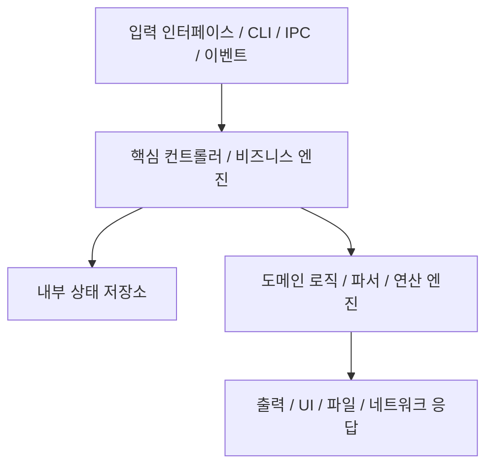

# 블랙박스 기능/애플리케이션 명세서: {{FEATURE_NAME_OR_APP_NAME}}

> **명세서 버전:** 1.0.0  
> **재구현 타깃 아키텍처:** macOS Apple Silicon Native (arm64 / Swift 6 / SwiftUI)  
> **클린룸 경계:** Room A 명세서 (원본 저작권 소스코드 일체 복사 금지)

---

## 1. 시스템 개요 및 목적
역공학을 통해 분석된 대상 컴포넌트 또는 애플리케이션의 핵심 책임, 비즈니스 로직, 기능적 목적을 요약합니다.

- **원본 바이너리/앱 경로:** `{{TARGET_ORIGINAL_PATH}}`
- **원본 아키텍처 및 기술 스택:** `{{ORIGINAL_STACK}}` (예: x86_64 Mach-O, Electron/Node.js, .NET C#, C++ Qt)
- **전환 목표 기술 스택:** Swift 6, SwiftUI / AppKit, 네이티브 `arm64-apple-macosx`

---

## 2. 핵심 아키텍처 및 컴포넌트 구성



### 2.1 상태 모델 및 라이프사이클
- **상태 정의:** `Uninitialized`, `Ready`, `Processing`, `Error`, `Terminated`
- **상태 전이 조건:** 이벤트나 입력 데이터에 따라 내부 상태가 어떻게 전이되는지 명시합니다.

---

## 3. 인터페이스 및 데이터 포맷

### 3.1 입력 포맷
- **파라미터 / 페이로드:**
  - `field_1` (타입: `String`, 필수): 설명 및 유효성 검증 규칙
  - `field_2` (타입: `UInt32` Little-Endian, 선택): 필드 설명
- **경계값 및 유효성 검증 규칙:**
  - 최대 버퍼 크기: `8192` 바이트
  - 인코딩: UTF-8 / Raw Byte Array

### 3.2 출력 포맷
- **성공 응답:**
  - 반환 구조체, 필드, 타입 및 기대 상태 코드 또는 반환값.
- **에러 모드 및 실패 코드:**
  - 특정 실패 조건, 예외 코드 및 에러 표현 방식.

---

## 4. 알고리즘 블랙박스 사양

> [!IMPORTANT]
> 디컴파일된 원본 C/C++ 소스코드나 어셈블리 명령어를 그대로 붙여넣지 마십시오. 의사코드(Pseudo-code)나 단계별 로직 설명으로 작성해야 합니다.

```text
알고리즘: ProcessPayload(input_buffer)
1. input_buffer의 길이가 HEADER_SIZE(16바이트) 이상인지 확인한다.
2. [0..3] 바이트에서 매직 바이트를 읽어 기대값과 일치하는지 검증한다.
3. 검증된 암호화/인코딩 방식을 통해 페이로드를 복호화/디코딩한다:
   - 암호화 방식: AES-256-GCM / ChaCha20-Poly1305 / 커스텀 XOR
   - IV / Nonce 도출: [4..15] 바이트 슬라이스
4. 구조화된 레코드로 파싱한다.
5. 강력한 타입(Type-safe)을 가진 결과 모델을 반환한다.
```

---

## 5. macOS Apple Silicon 네이티브 연동 요구사항

- **동시성 모델:** Swift `async`/`await`, `TaskGroup`, UI 업데이트를 위한 `@MainActor`.
- **메모리 및 하드웨어 가속:** Swift 표준 라이브러리, 연산 집약적 작업 시 `Accelerate.framework` / `Metal` 활용.
- **macOS 시스템 연동:**
  - CLI 도구: Apple 공식 `swift-argument-parser`
  - GUI 앱: SwiftUI Window / NavigationSplitView, macOS 14+ / 15+ 타깃
  - 메뉴바 / 데몬: `MenuBarExtra`, `SMAppService` (launchd 데몬 관리)

---

## 6. 테스트 벡터 및 오라클 검증 데이터

| 테스트 케이스 ID | 입력 벡터 / 인자 | 기대 출력 / 상태 | 비고 |
| :--- | :--- | :--- | :--- |
| `TC-01` (정상 시나리오) | `sample_input_01.dat` | 상태 `OK`, 페이로드 일치 | 기본 해피 패스 검증 |
| `TC-02` (경계값) | 0바이트 빈 버퍼 | 에러 `ErrBufferTooShort` | 최소 경계값 예외 검증 |
| `TC-03` (손상된 데이터) | 잘못된 매직 헤더 | 에러 `ErrInvalidMagic` | 비정상 입력 방어 검증 |

---

## 7. 분석 근거(Evidence) 및 추적 로그

| 식별 항목 / 동작 | 관측 지점 (심볼 / 문자열 / 오프셋) | 신뢰 수준 | 비고 |
| :--- | :--- | :--- | :--- |
| 핸드셰이크 시퀀스 | 문자열 `"AUTH_V2_CLIENT_HELLO"`, 오프셋 `0x10003A4B0` | 확실(Definite) | 문자열 테이블 및 호출 흐름 교차 확인 |
| 프레이밍 프로토콜 | 함수 `parse_header`, 동적 라이브러리 `libcore.dylib` | 추정(Inferred) | 4바이트 빅엔디안 길이 헤더 확인 |
