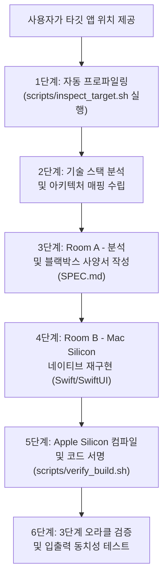

# 에이전트 실행 규칙 및 워크플로우 정의서: 역공학 및 Apple Silicon 재개발

본 문서는 사용자가 특정 애플리케이션의 위치를 제공했을 때, AI 에이전트와 엔지니어가 이를 분석하고 최신 macOS Apple Silicon (`arm64`) 네이티브 애플리케이션으로 안전하게 재개발하기 위해 준수해야 하는 **엄격한 행동 규칙(Rules) 및 표준 운영 절차(SOP)**를 정의합니다.

---

## 0. 가장 빠른 LLM CLI 실행 방법 (One-Line Execution)

터미널에서 `aaa.app` 위치만 지정하여 즉시 전체 파이프라인을 구동할 수 있습니다:

```bash
# 방법 1: 원터치 래퍼 스크립트 실행 (권장)
./scripts/rebuild_app.sh /Applications/aaa.app

# 방법 2: agy (Antigravity CLI) 직접 호출
agy "이 앱 분석해서 Apple Silicon 네이티브로 재개발해줘: /Applications/aaa.app"

# 방법 3: claude CLI 직접 호출
claude "Analyze and rebuild for Apple Silicon Native: /Applications/aaa.app"
```

---

## 1. 트리거 조건 및 기본 동작 계약

사용자가 애플리케이션 경로(예: `/Applications/Target.app`, `./bin/binary`, 로컬 번들 등)를 제공하면, 에이전트는 **반드시** 다음 프로토콜을 활성화해야 합니다:

1. **규칙 문서 우선 탐색**: 어떠한 코드 작성이나 분석에 앞서 다음 문서를 확인합니다:
   - `docs/kr/MAC_SILICON_REBUILD_GUIDE.md` (또는 영문 버전)
   - `docs/kr/SPEC_TEMPLATE.md`
   - `docs/kr/PROMPTS.md`
2. **Mac Silicon Native 최우선 원칙**: 사용자가 별도로 다른 플랫폼을 명시하지 않는 한, 모든 재개발 작업은 **Swift 6 / SwiftUI / AppKit 기반의 Apple Silicon (`arm64-apple-macosx`) 네이티브**를 기본 타깃으로 삼습니다.
3. **위트 있는 명칭 변경 (Witty Homage Naming)**: 원작 앱의 이름을 그대로 사용하는 것을 엄격히 금지합니다. 상표권 보호 및 사용자 친화성을 위해 원작의 특징을 연상시키는 재치 있는 패러디/오마주 이름(예: `Calculator` -> `Calcuroo`, `Postman` -> `PacketBoy`, `Notion` -> `Epiphany`)을 채택해야 합니다.
4. **특징적 아이콘 및 비주얼 필수 제작 (Distinctive Branding & AppIcon)**: 모든 앱 프로젝트에는 macOS Big Sur+ 스타일의 고해상도 앱 아이콘(`AppIcon.icns`, `icon_1024.png`)과 시그니처 테마 색상을 필수로 제작하여 번들에 포함해야 합니다 (`./scripts/generate_app_icon.swift` 활용).
5. **클린룸 격리 준수**: 원본 프로그램의 비공개 디컴파일 C/C++ 코드나 어셈블리를 재개발 소스코드에 절대 직접 복사하지 않으며, 반드시 블랙박스 명세서(`SPEC.md`)를 거쳐 구현합니다.

---

## 2. 표준 운영 절차 (SOP: Standard Operating Procedure)



### 1단계: 자동 진단 스크립트 실행 (Inspect)
제공받은 타깃 경로를 대상으로 내장 진단 스크립트를 즉시 실행합니다:
```bash
./scripts/inspect_target.sh <타깃_경로>
```
확인할 핵심 정보:
- `.app` 내부 실행 바이너리 위치 (`Contents/MacOS/<실행파일명>`)
- 지원 아키텍처 슬라이스 (`arm64`, `x86_64`, Fat 바이너리)
- 동적 라이브러리 및 시스템 프레임워크 링크 목록 (`otool -L`)
- 런타임 기술 스택 지문 (Electron, Qt, .NET, Go, Python, Swift, Objective-C 등)

### 2단계: 기술 스택 분석 및 아키텍처 매핑 계획 수립
`docs/kr/MAC_SILICON_REBUILD_GUIDE.md`의 전환 매트릭스를 기반으로 재개발 전략을 수립합니다:
- **Electron / 웹 번들**: 무거운 Chromium/Node를 걷어내고 순수 **SwiftUI** 데스크톱 앱으로 전환, IPC를 Swift `actor` 모델로 대체.
- **CLI 도구 / 백그라운드 서비스**: Apple 공식 `swift-argument-parser` 및 `SMAppService` 기반 네이티브 데몬 패키지 설계.
- **C++/Qt/.NET GUI 앱**: 선언형 SwiftUI 인터페이스와 `@Observable` 데이터 모델로 전환.

### 3단계: Room A – 블랙박스 사양서 추출 (`SPEC.md`) 및 위트 있는 작명
1. 원본 상표를 대체할 **위트 있는 패러디/오마주 명칭**을 정하고, 시그니처 심볼(이모지/SF Symbols)과 테마 색상(Primary/Secondary Hex)을 선정합니다.
2. REA 분석 도구(Ghidra, Hopper, strings, AST 분석기 등)를 활용하여 핵심 엔트리포인트와 비즈니스 로직을 분석합니다.
3. `docs/kr/SPEC_TEMPLATE.md` 템플릿에 맞추어 `SPEC.md`를 작성합니다.
4. 모든 알고리즘은 의사코드(Pseudo-code)로 작성하고, 입출력 테스트 벡터를 6번 섹션에 명시합니다.

### 4단계: Room B – 클린룸 네이티브 신규 구현 및 앱 아이콘 제작
1. Swift 패키지 또는 앱 프로젝트 구조를 생성합니다:
   ```bash
   mkdir -p rebuilt_app/Sources rebuilt_app/Resources rebuilt_app/Tests
   ```
2. 고유 앱 아이콘(`AppIcon.icns`)을 자동 생성합니다:
   ```bash
   ./scripts/generate_app_icon.swift "<위트있는앱이름>" rebuilt_app/Resources "<심볼이모지>" "#Hex1" "#Hex2"
   ```
3. `arm64-apple-macosx14.0+`을 타깃으로 하는 `Package.swift`를 작성합니다.
4. `SPEC.md`의 요구사항에 맞추어 Swift 6 엄격한 동시성을 준수하는 네이티브 코드를 작성합니다.

### 5단계: Apple Silicon 네이티브 컴파일 및 Ad-hoc 코드 서명
Apple Silicon 네이티브 머신 코드로 빌드합니다:
```bash
arch -arm64 swift build -c release --triple arm64-apple-macosx14.0
```
생성된 바이너리에 Ad-hoc 코드 서명을 적용합니다:
```bash
codesign --force --deep --sign - .build/arm64-apple-macosx/release/<바이너리명>
```

### 6단계: 오라클 검증 및 차이점 테스트
검증 스크립트를 실행하여 테스트를 수행합니다:
```bash
./scripts/verify_build.sh rebuilt_app
```
`SPEC.md`에 정의된 모든 테스트 케이스 벡터에 대해 원본과 재개발 결과물의 입출력 동치성을 확인합니다.

### 7단계: 배포용 Drag-and-Drop DMG 생성 (/Applications 설치 간편화)
macOS 사용자가 앱을 손쉽게 `/Applications` 폴더로 드래그하여 설치할 수 있도록 `.dmg` 인스톨러를 제작합니다:
```bash
./scripts/create_dmg.sh rebuilt_app
# 또는 빌드된 .app 지정:
./scripts/create_dmg.sh dist/Calcuroo.app dist/Calcuroo-1.0.0-arm64.dmg
```
스크립트는 자동으로 `.app` 번들 구성, `Info.plist` 및 `AppIcon.icns` 탑재, Ad-hoc 코드 서명, `/Applications` 심볼릭 링크 생성, UDZO 압축 이미지 검증을 완료합니다.

---

## 3. 필수 품질 및 안전 보증 규칙

1. **저작권 원본 코드 오염 방지**: 디컴파일된 C/C++ 소스코드 조각이나 역어셈블리 목록이 최종 재개발 소스코드에 일체 포함되지 않았는지 확인.
2. **Apple Silicon 네이티브 바이너리 확인**: `file <바이너리>` 실행 결과 `Mach-O 64-bit executable arm64`가 정상 표시되는지 검증.
3. **Swift 6 동시성 안전성**: 데이터 레이스(Data Race) 컴파일러 경고가 전혀 발생하지 않는지 확인.
4. **배포 완성도**: macOS 사용자를 위한 `/Applications` 드래그 앤 드롭 링크가 포함된 `.dmg` 파일이 정상 마운트되고 검증(`hdiutil verify`)되는지 확인.
